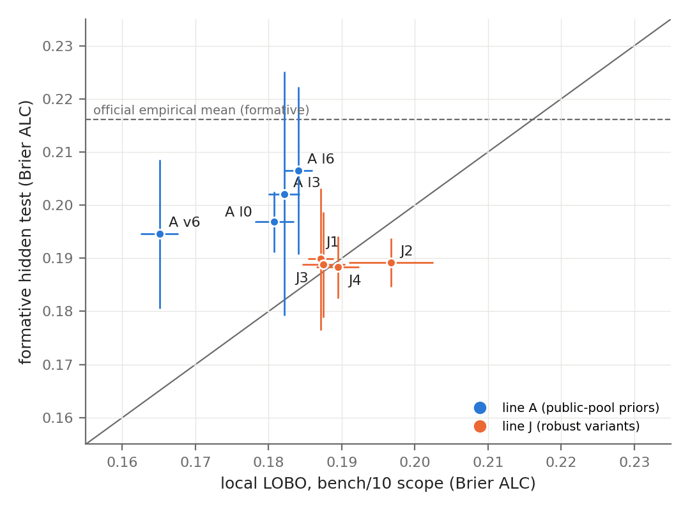

# What transfers to an unseen benchmark? Local validation against hidden-test feedback in PAIEC

Team Yamasaki. Ivan Goya Yamasaki, Instituto Tecnológico de Aeronáutica (ITA), Brazil, ivangyamasaki@gmail.com.

Technical report for the Predictive AI Evaluation Competition (PAIEC), NeurIPS 2026 workshop. Draft v4, 2026-10-14. [CORTE] marks numbers that change when the formative runs are frozen on 2026-10-25; `report/make_table3.py` regenerates Table 3 and prints the other [CORTE] values. [TBD] marks items that wait for the author.

## Abstract

PAIEC asks for the probability that an AI system solves an item from a benchmark it has never seen, given 0 to 31 revealed labels and, in `labeled`, outcomes of other sampled systems. We built a local leave-one-benchmark-out (LOBO) evaluator and used it to develop a family of Bayesian models: a Rasch model with a benchmark-level prior, system-metadata offsets, item effects learned online and an LLM difficulty note. Locally these components help; the LLM note alone takes the Brier ALC from 0.1856 to 0.1626. On the hidden test the ranking does not hold. Over [CORTE] 122 valid formative submissions on Codabench, our eight arms score between [CORTE] 0.187 and 0.207, against 0.221 for the official empirical-mean baseline. Four arms beat the baseline under a multiple-comparison correction, by 0.031 to 0.034 in Brier ALC. None of the seven comparisons between our own arms reached significance, and the largest difference among them was 0.0023. We submit the simplest arm: a Beta posterior for the pair centred on the mean label of other systems on the same benchmark, with no fitted parameter (J2, [CORTE] 0.1881, 95% CI [0.1815, 0.1947], n = 22). In the local scope closest to a formative run it was the worst of our models (0.1967). Metadata offsets are the clearest failure: removing them takes B0 from 0.318 to 0.250. We report the discrepancy, the causes we can and cannot test, and the components that did not enter the final solution. Code: https://github.com/IvanYamasaki/paiec-yamasaki.

## 1. Introduction

The PAIEC predictor receives one item at a time: a subject (an AI system with its harness), an item from a hidden benchmark, and a list `labeled` of revealed outcomes [1]. Every test benchmark is new, because the organizers split benchmarks into training and test pools before curation [1]. A model can reuse only what holds across benchmarks, and the public pool has four eligible benchmarks to check that with.

We spent the first week the usual way. We wrote a local evaluator that imitates the official protocol, ran ten lines of work against it (A to J in the repository) and kept what lowered the local score. That process produced a model at 0.164 on local LOBO, 0.06 below the official baseline. Then the Codabench formative runs, which score a fresh sample of the hidden test at each submission, put all of our variants within 0.02 of each other, with the simplest one tied for first.

This report makes three points.

1. Under benchmark shift, the local LOBO ranking of our models did not predict their hidden-test ranking. The model that ignores the public pool entirely is statistically indistinguishable from every model that learns from it (Section 6).
2. The failure has a visible mechanism at budget 0. Offsets learned from system metadata on the public benchmarks make B0 worse than predicting 0.5 (Section 6.3).
3. Several signals that pass every local check, including an LLM difficulty note, item effects and an amortized in-context learner, were never shown to transfer. We describe them briefly with the reason each one stayed out (Section 7).

## 2. Task and protocol

The protocol comes from the competition page [1] and the official client `paiec_baseline/tools/streaming_ingestion.py` [2]. A pair is a (subject, benchmark) combination with at least 80 distinct items. Its items are split 50/50 at random into an acquisition pool and an evaluation pool. By default, acquisition buys labels with probability labels_remaining / items_remaining and ends with 31 labels. The evaluation pool is scored after 0, 1, 3, 7, 15 and 31 labels of the same nested trajectory:

Brier ALC = 0.1·B0 + 0.2·B1 + 0.2·B3 + 0.2·B7 + 0.2·B15 + 0.1·B31,

averaged over pairs [1]. The page states that "labeled contains [[subject, item], label] entries across sampled subject–benchmark pairs" [1], so the model also sees outcomes of other systems. In the official client `predict` runs item by item in workers recreated at every checkpoint [2]. Each formative evaluation samples at most 1,000 subject-item pairs [1], which gave 8 to 9 subject-benchmark pairs per submission in our runs. Submissions run for at most 28,800 s [4].

## 3. Data

All training and selection use the public `aims-foundations/measurement-db` dataset [3], revision of 2026-09-18 (Table 1, from `paiec/describe_data.py`). No other data and no external leaderboard data enter any model. J2 itself uses no training data; its two constants were picked on simulations built from this dataset (Section 5.2).

Table 1. Public benchmarks. For the two non-binary ones the rate is binarized at response ≥ 0.5.

| benchmark | binary | subjects | items | rate | pairs ≥ 80 items |
|---|---|---|---|---|---|
| matharena | no | 104 | 1,755 | 0.70 | 81 |
| mmdocrag | no | 68 | 2,000 | 0.78 | 68 |
| multi_swebench | yes | 82 | 2,126 | 0.148 | 82 |
| real_webagents | yes | 33 | 233 | 0.373 | 26 |
| researchcodebench | yes | 31 | 212 | 0.353 | 31 |
| swe_rebench | yes | 1 | 6,306 | 0.471 | 1 |

Only the four binary benchmarks are eligible under the official preparation rule [2]. They give 140 evaluable pairs, 82 of them from multi_swebench, and swe_rebench has one subject. The binary rates span 0.15 to 0.47. No item content repeats across the six benchmarks (0 shared SHA-1 among 11,692 contents, `paiec/advisor/check2_coverage.py`, not in the public repository), so items of the test cannot be recognized by content.

## 4. Local evaluation

`paiec/eval_local.py` reproduces the protocol. Pool splits, stream order and acquisition depend only on (seed, pair), so all models see the same items in the same order. The main split is LOBO: train on three binary benchmarks, score the pairs of the fourth. We use three scopes for `labeled`. In `pair`, it holds only the target pair's labels (140 pairs scored). In `bench/10` (`--labeled-scope benchmark --max-pairs-per-bench 10`), at most 10 pairs per benchmark are co-sampled and each sees the first k labels of the others; this imitates the size of a formative run but scores only 31 pairs, so it is not comparable with `pair`. In `bench`, all pairs of the held-out benchmark are co-sampled.

`--stress` adds two folds, matharena and mmdocrag binarized, trained on the four binary benchmarks. Their pair rates are 0.64 and 0.78, outside the range of the binary benchmarks. `--strict` replays a 5% sample of pairs item by item from a fresh copy of the module state and fails if any prediction changes by more than 1e-9, which catches state carried between calls. Every local number below passes `--strict` and is the mean ± sample standard deviation over seeds 0, 1 and 2 from `paiec/results/*.json` and `paiec/report/runs/*.json`.

## 5. Models

### 5.1 The model family we developed

The development model (line A, `lines/A_bayes/v7/model.py`) is a Rasch model fitted inside the test benchmark, logit P(y = 1) = θ_j + d_i, with three priors learned from the public pool.

- The benchmark level μ_b has a prior centred on the training levels with variance at least 1 on the logit scale. Variant v7 mixes it with a spread of levels from 10% to 95% with weight λ (arms l0, l3, l6 for λ = 0, 0.3, 0.6).
- The system ability θ_j is shifted by a ridge regression on release year, reasoning effort, an agentic-scaffold flag and a cross-benchmark name score, calibrated by nested LOBO with a benchmark fixed effect.
- The item easiness d_i has a prior from an `item_features` category and, in v6, from an LLM success note (Section 7). When `labeled` holds other systems' labels on the same benchmark, μ_b, their abilities and the d_i are fitted jointly by MAP, and the target θ is computed on an exact grid.

Line J (`lines/J_robusto/`) built robust variants of it. J1 centres the level prior at p = 0.5 and multiplies its variance by 8. J4 is J1 without the metadata offset. J3 blends J1 with J2 using a weight that moves to J1 as labels accumulate.

### 5.2 The final candidate: J2

J2 has no fitted parameter. For a target pair with s successes in n own labels, and S successes in N labels from other systems on the same `benchmark_id`, it predicts

p0 = (S + 4 · 0.5) / (N + 4),  p = (s + 2 · p0) / (n + 2).

It is a Beta posterior for the pair, centred on a level estimated from the other systems and shrunk toward 0.5. The constants a = 2 and a0 = 4 were picked on the shifted-level simulator of line J (Section 6.3) from a grid of 1, 2 and 4. The whole predictor is 12 lines (`lines/J_robusto/submit_J2_min/model.py:20-31`):

```python
def predict(input, labeled=None):
    subject, item = input
    bench, sk = item.get("benchmark_id"), _key(subject)
    s = n = so = no = 0
    for (sub, it), y in labeled or []:
        if it.get("benchmark_id") != bench:
            continue
        if _key(sub) == sk:
            s, n = s + int(y), n + 1
        else:
            so, no = so + int(y), no + 1
    p0 = (so + CFG["a0"] * 0.5) / (no + CFG["a0"])
    return float((s + CFG["a"] * p0) / (n + CFG["a"]))
```

It imports only `json` and `os`, and `check_pack.py` measured a worst case of 4.2 ms per call with 2,542 labels in `labeled`. We submit J2 because it ties with every other arm on the hidden test (Section 6.2) and is the easiest to audit. J4 has the lowest formative mean [CORTE] and is the fallback if the frozen numbers separate the two. The organizers take the final choice by e-mail, which identifies the selected Codabench submission [1]. [TBD at the cut: final package and Codabench submission ID.]

## 6. Results

### 6.1 Local LOBO

Table 2 shows the local picture that guided development. Commands: `eval_local.py --model <dir> --seed {0,1,2} --strict --stress`, plus `--labeled-scope benchmark --max-pairs-per-bench 10` for the `bench/10` column (`lines/J_robusto/runeval.sh` runs both; the runs added for this draft, J3 and J4 seeds 1 and 2 in `pair`, their three `bench/10` seeds and A v6 seed 1 in `bench/10`, come from `report/runs/run_missing.sh`).

Table 2. Local LOBO, 3 seeds. Stress columns are means over seeds in the `pair` scope.

| model | dir | pair | bench/10 | B0 (pair) | matharena | mmdocrag |
|---|---|---|---|---|---|---|
| constant 0.5 | `models/constant` | 0.2500 | | 0.250 | 0.250 | 0.250 |
| official empirical mean | `models/official_empirical_mean` | 0.2213 ± 0.0020 | | 0.250 | 0.256 (s0) | 0.183 (s0) |
| A v6, with Sonnet note | `lines/A_bayes/v6` | 0.1640 ± 0.0016 | 0.1651 ± 0.0026 | 0.174 | 0.2256 | 0.2151 |
| A v7 l0, no note | `lines/A_bayes/v7_l0` | 0.1844 ± 0.0015 | 0.1808 ± 0.0027 | 0.205 | 0.2293 | 0.2159 |
| A v7 l3 | `lines/A_bayes/v7_l3` | 0.1866 ± 0.0013 | 0.1821 ± 0.0022 | 0.211 | 0.2203 | 0.1911 |
| A v7 l6 | `lines/A_bayes/v7_l6` | 0.1900 ± 0.0011 | 0.1841 ± 0.0019 | 0.224 | 0.2147 | 0.1773 |
| J1 robust level | `lines/J_robusto/submit_J1_rob` | 0.1964 ± 0.0010 | 0.1871 ± 0.0017 | 0.246 | 0.2161 | 0.1640 |
| J2 minimal | `lines/J_robusto/submit_J2_min` | 0.1960 ± 0.0008 | 0.1967 ± 0.0057 | 0.250 | 0.2163 | 0.1663 |
| J3 hybrid | `lines/J_robusto/submit_J3_hib` | 0.1961 ± 0.0009 | 0.1875 ± 0.0029 | 0.250 | 0.2169 | 0.1644 |
| J4 J1 without metadata | `lines/J_robusto/submit_J4_rasch` | 0.1974 ± 0.0011 | 0.1895 ± 0.0030 | 0.250 | 0.2201 | 0.1636 |

Locally, the learned components of the A family pay. In `bench/10`, the scope closest to a formative run, l0 beats J2 by 0.016. Robustness to high-rate benchmarks has a price: moving the level prior toward 0.5 (l3, l6, J1) lowers the stress folds and raises the LOBO score. J3 and J4 land between J1 and J2 in `bench/10` (0.1875 and 0.1895) and level with them in `pair`. Their B0 is 0.250 because both predict 0.5 at k = 0.

### 6.2 Hidden test: the formative runs

From 2026-10-05 to [CORTE] 2026-10-08 we rotated nine arms through the Codabench formative phase (competition 17828, phase 29785). Each submission draws new pairs, so submissions of one arm are independent draws. Table 3 aggregates them (`paiec/formativo/RESULTADOS.md`, built by `paiec/formativo/summary.py`). About 15% of submissions ended in an infrastructure error or stayed stuck; one counts only when its scoring output has all six budgets and its mean matches the leaderboard score within 1e-5 (`paiec/formativo/rounds.py`).

Table 3. Formative Brier ALC per arm, as of 2026-10-13 [CORTE]. CI = mean ± 1.96·SD/√n. Regenerate with `python report/make_table3.py`.

| arm | n | mean | 95% CI | B0 | B1 | B3 | B7 | B15 | B31 | ECE |
|---|---|---|---|---|---|---|---|---|---|---|
| J4 (J1 without metadata) | 25 | 0.1873 | [0.1792, 0.1954] | 0.250 | 0.207 | 0.187 | 0.173 | 0.164 | 0.160 | 0.137 |
| J2 minimal | 22 | 0.1881 | [0.1815, 0.1947] | 0.250 | 0.208 | 0.187 | 0.173 | 0.166 | 0.163 | 0.134 |
| J3 hybrid | 18 | 0.1888 | [0.1789, 0.1987] | 0.250 | 0.215 | 0.190 | 0.170 | 0.164 | 0.161 | 0.139 |
| J1 robust level | 12 | 0.1899 | [0.1765, 0.2032] | 0.318 | 0.226 | 0.177 | 0.160 | 0.153 | 0.149 | 0.155 |
| A v7 l0 | 15 | 0.1901 | [0.1803, 0.1998] | 0.253 | 0.216 | 0.194 | 0.171 | 0.163 | 0.159 | 0.149 |
| A v6 (note absent on test items) | 7 | 0.1946 | [0.1806, 0.2085] | 0.246 | 0.220 | 0.196 | 0.178 | 0.173 | 0.167 | 0.133 |
| A v7 l3 | 5 | 0.2021 | [0.1792, 0.2251] | 0.271 | 0.225 | 0.210 | 0.183 | 0.174 | 0.167 | 0.160 |
| A v7 l6 | 5 | 0.2065 | [0.1908, 0.2222] | 0.303 | 0.237 | 0.206 | 0.181 | 0.173 | 0.167 | 0.160 |
| official empirical mean | 13 | 0.2210 | [0.2086, 0.2335] | 0.250 | 0.320 | 0.222 | 0.182 | 0.171 | 0.169 | 0.169 |

Single submissions of the same arm vary a lot. J2 ranged from [CORTE] 0.1495 to 0.2126. With about 9 pairs per draw, the standard deviation within an arm is [CORTE] 0.016 to 0.026, larger than the 0.0113 another team reports for one artifact submitted 9 times [8]. The intervals of all our arms overlap each other.

Each comparison is a hypothesis registered in our experiment log, with Brier ALC as the metric, at least 8 submissions per arm, and a correction for multiple comparisons across the formative family. Table 4 lists the verdicts. The n in each row is the count when the verdict was declared, so it can be lower than in Table 3.

Table 4. Laboratory verdicts. Difference = mean of the reference arm minus mean of the tested arm; positive favours the tested arm.

| id | tested arm vs reference | n (ref, tested) | difference | 95% CI | adjusted p | verdict |
|---|---|---|---|---|---|---|
| h23 | J4 vs empirical mean | 13, 23 | 0.0343 | [0.0206, 0.0490] | 0.002 | supported, re-checked |
| h14 | J2 vs empirical mean | 13, 21 | 0.0334 | [0.0200, 0.0475] | 0.004 | supported, re-checked |
| h22 | J3 vs empirical mean | 13, 18 | 0.0322 | [0.0169, 0.0480] | 0.006 | supported, re-check pending [CORTE] |
| h17 | J1 vs empirical mean | 13, 12 | 0.0312 | [0.0135, 0.0485] | 0.034 | supported, re-checked |
| h24 | J4 vs l0 | 12, 23 | 0.0015 | [-0.0115, 0.0139] | 1 | inconclusive |
| h20 | J3 vs J1 | 12, 18 | 0.0011 | [-0.0146, 0.0169] | 1 | inconclusive |
| h21 | J4 vs J2 | 21, 23 | 0.0009 | [-0.0096, 0.0114] | 1 | inconclusive |
| h18 | J2 vs l0 | 12, 21 | 0.0006 | [-0.0117, 0.0126] | 1 | inconclusive |
| h19 | J3 vs J2 | 21, 18 | -0.0012 | [-0.0129, 0.0106] | 1 | inconclusive |
| h13 | J1 vs l0 | 12, 12 | -0.0016 | [-0.0183, 0.0143] | 1 | inconclusive |
| h15 | J1 vs J2 | 21, 12 | -0.0023 | [-0.0171, 0.0117] | 1 | inconclusive |

"Re-checked" means a separate run of the laboratory resubmitted both arms to Codabench with new draws, found the new scores inside the 95% prediction interval of each arm, and found no leak between training and test in the code. Four arms, J1 to J4, beat the official baseline. No comparison between two of our arms comes close to significance: the largest difference is 0.0023, against intervals about 0.025 wide. Comparisons that involve A v6, l3 or l6 have fewer than 8 submissions per arm and no verdict.

Table 5 and Figure 1 put the two rankings side by side.

Table 5. Local LOBO against the formative mean. bench/10 is the local scope closest to a formative run. Formative column as of 2026-10-13 [CORTE].

| arm | local pair | local bench/10 | formative | formative minus bench/10 |
|---|---|---|---|---|
| A v6 (note) | 0.1640 | 0.1651 | 0.1946 | +0.030 |
| A v7 l0 | 0.1844 | 0.1808 | 0.1901 | +0.009 |
| A v7 l3 | 0.1866 | 0.1821 | 0.2021 | +0.020 |
| A v7 l6 | 0.1900 | 0.1841 | 0.2065 | +0.022 |
| J1 | 0.1964 | 0.1871 | 0.1899 | +0.003 |
| J3 | 0.1961 | 0.1875 | 0.1888 | +0.001 |
| J4 | 0.1974 | 0.1895 | 0.1873 | -0.002 |
| J2 | 0.1960 | 0.1967 | 0.1881 | -0.009 |
| official empirical mean | 0.2213 | | 0.2210 | |



Figure 1. Local `bench/10` Brier ALC (x, mean ± SD over 3 seeds) against the formative mean (y, 95% CI) for each arm. Points above the diagonal did worse on the hidden test than locally. The dashed line is the formative score of the official empirical-mean baseline. Script: `report/make_fig.py`.

The official baseline, which learns nothing from the public pool, scores the same locally and on the test. The arms that lean most on the public pool lose most: A v6, l3 and l6 are 0.020 to 0.030 worse on the test than in `bench/10`. Part of the A v6 loss is mechanical. Its LLM note covers only public items and is absent on the test, so its 0.020 of local advantage over l0 in `pair` was never available there. J2 and J4, the two arms with no metadata offset, are the only ones that score better on the test than in `bench/10`, by 0.009 and 0.002. J3, which hands over to J1 and its metadata after the first labels, is level (+0.001).

We had two explanations for J2 doing better on the test than locally, and both are hypotheses about data we cannot see: the hidden benchmarks may be more homogeneous inside than the public ones, or `labeled` may carry more co-sampled pairs per benchmark than our `bench/10` scope assumes. We tested the second one locally. In the benchmark scope the scored pair sets are nested, so the 31 pairs of `bench/10` are scored again with 20 and 40 co-sampled pairs per benchmark. On those 31 pairs J2 moves from 0.1967 to 0.1955 and 0.1951 (3 seeds each, all `--strict`; `report/runs/item8.py`). Most of the change is seed 2 (0.1975 to 0.1931); seeds 0 and 1 move by 0.0002. In our data, then, more co-sampled pairs account for at most 0.002 of the 0.009 by which J2 improves on the test. The first explanation, more homogeneous hidden benchmarks, remains untested.

### 6.3 Where the gap comes from

The B0 column of Table 3 isolates the first cause. At k = 0 J2 predicts 0.5, and its B0 is exactly 0.2500 in all [CORTE] 22 draws. This also shows that at checkpoint 0 `labeled` holds no label of another system on the same benchmark, otherwise p0 would move. J4 is J1 with the metadata offset turned off and nothing else changed. Its B0 is 0.250 against 0.318 for J1, while locally the two were close (`pair` ALC 0.1974 against 0.1964, B0 0.250 against 0.246, Table 2). We infer, without direct evidence, that the metadata offset is what hurts, since we do not see the test subjects: in J1 a 2026 system with high reasoning effort gets 0.673 at k = 0 from the year and reasoning offsets, which would cost Brier if the test pairs have low or mixed rates. The arms that apply a learned level or metadata shift at k = 0 have B0 above 0.25, the score of the constant 0.5 ([CORTE] l0 0.253, l3 0.271, l6 0.303, J1 0.318); A v6 is the exception at 0.246.

The second cause is the level prior. On the public pool, a prior fitted to the binary benchmarks is too narrow for a benchmark at rate 0.64 or 0.78, and the stress folds show it. A simulation with the real pair rates (`paiec/advisor/check4_prior_shift.py`, not in the public repository) gives a macro ALC of 0.2548 on the two high-rate benchmarks for a prior N(-1.2, 1.0), against 0.2089 for N(-0.6, 2.0). Line J resampled each test benchmark from its own Rasch fit with a shifted level, q from 0.05 to 0.95 (`lines/J_robusto/jsim.py`, at most 30 pairs per benchmark). In the `pair` scope the mean over q is 0.1811 for l0, 0.1665 for J1 and 0.1685 for J2, and the worst B0 over q is 0.465 for l0. We used that simulator to move toward J1 and J2. On the test, the spread arms l3 and l6 had higher means than l0, which suggests that the hidden levels were not simply high; with 5 submissions each, this is not a tested result. A prior centred at 0.5 without metadata (J2, J4) was the safe choice at k = 0.

At larger budgets the gap shrinks. J1 has the best B3 to B31 on the test (B31 [CORTE] 0.149 against 0.163 for J2), so its Rasch structure helps once the pair has its own labels. J3 tried to combine J2 at k = 0 with J1 later; it ends level with J2 ([CORTE] 0.1888 against 0.1881, h19 inconclusive).

## 7. What we explored and why it did not enter

Table 6 lists the components that improved the local score or were expected to, with their local effect and the reason they stayed out. Every number is in the line log named in the last column. The LLM notes and scores behind the LLM rows are not released (Section 9).

Table 6. Explored components (local LOBO unless stated).

| component | local result | why it is not in the final solution | log |
|---|---|---|---|
| LLM success note (Sonnet) as item prior | 0.1856 → 0.1626 (`pair`), 0.1710 → 0.1526 (`bench`) | needs an approved API at test time; we decided against any LLM or API in the final solution, and two public teams report that LLM item signals did not transfer in their tests [6], [7] | B |
| same note from an open model (Qwen3.5-4B, local) | 0.1856 → 0.1803 | keeps a fifth of the gain and makes real_webagents worse by 0.006 | B |
| pairwise or batch prompts (line I) | Spearman with easiness +0.13 ± 0.05 over absolute scores (Sonnet, 300 items) | same API dependency; the combined note gained 0.0017 in the simulator | I |
| 13-dimension LLM rubric | 0.1619 vs 0.1622 for the single note | no gain; only 3 of 13 dimensions keep their sign across the 6 benchmarks | H |
| online Rasch with the note and a learned slope (F v1) | 0.1591 (`pair`), 0.1648 (`bench/10`) | best local model; same note dependency, and its non-note part is the A family that lost on the test | F |
| amortized in-context learner (graph neural process) | 0.1661 vs 0.1591 for F v1 | worse locally; under a Rasch prior the exact grid posterior is already what it approximates | G |
| text regression to difficulty (TF-IDF, embeddings) | Spearman on a held-out benchmark -0.22 to +0.09; 0.22 to 0.45 within benchmark | the text-to-difficulty map changes between benchmarks | B |
| importance weighting of that regression | no change; 75 to 97% of the weight on swe_rebench | reweighting inputs cannot fix a change in P(difficulty given text) | B |
| uncertainty-based acquisition | ceiling of 0.0044 with oracle difficulties; worse by 0.003 at correlation 0.4 | needs accurate item difficulty, which the test does not give | E |
| post-hoc calibration per budget | -0.0013 to +0.0017 per fold | no stable gain; harmful at k = 0 | D |

Two rows deserve a sentence more. The text regression is a case of concept shift, not covariate shift. The same regressor that ranks items with Spearman up to 0.45 inside a benchmark changes sign on a new one, and density-ratio weights do nothing because the conditional distribution moved, not the inputs. Krsteski and Meyer report a held-out-benchmark Spearman of 0.017 for embedding features [5]. The LLM note is the one item signal that transferred across our four local folds. We still cannot claim it transfers to the hidden test, because no submitted package computed it on test items.

## 8. Limitations

- The formative runs are the only hidden-test evidence, with [CORTE] 5 to 25 draws per arm and about 9 pairs per draw. Differences between our arms are inside the intervals, and every pairwise verdict between them is inconclusive.
- Formative draws are not paired across arms, so the comparison is between independent samples and loses power.
- Local LOBO has four folds, one with a single pair, and 59% of the pairs are from multi_swebench. Seed standard deviations measure pool-split noise, not benchmark-to-benchmark variation.
- The explanation of the B0 failure through metadata offsets is an inference from the J1 against J4 contrast; we do not see the test subjects.
- The constants of J2 were picked on our own shifted-level simulator, which keeps the item structure of the public benchmarks.

## 9. Reproducibility

Environment: Windows 11, Python 3.12.10, numpy 2.5.3, pandas 3.0.6, pyarrow 25.0.1, scikit-learn 1.9.1, scipy 1.18.1, huggingface_hub 2.1.1; official baseline at commit 82d330d. All local runs used one laptop with an Intel Core i5-12450HX (8 cores, 12 threads) and 32 GB of RAM, one evaluation process at a time. The J2 package uses only the Python standard library. Code: https://github.com/IvanYamasaki/paiec-yamasaki (branch main). The repository holds the evaluator, the code of every line and the J2 package. It does not include the LLM item notes and scores of Section 7 (`notes.csv`, `scores.csv`), so the rows of Table 6 that use them cannot be rerun from the repository.

```bash
py -3.12 -m venv .venv
.venv/Scripts/python -m pip install numpy pandas pyarrow scikit-learn scipy huggingface_hub
git clone https://github.com/aims-foundations/paiec_baseline
# measurement-db is gated: request access on Hugging Face, save a read token in paiec/.hf_token
.venv/Scripts/python download_data.py           # about 70 MB
.venv/Scripts/python describe_data.py           # Table 1

# Table 2: one model, pair and bench/10 scopes, seeds 0-2, strict, stress folds
bash lines/J_robusto/runeval.sh lines/J_robusto/submit_J2_min J2

# package check: imports in a numpy/pandas/pyarrow-only venv, purity, latency
.venv/Scripts/python lines/D_calib/pack/check_pack.py --model lines/J_robusto/submit_J2_min

# Table 3: aggregate the downloaded formative scores in formativo/metrics/ (submitting needs a Codabench account)
.venv/Scripts/python formativo/summary.py
.venv/Scripts/python report/make_table3.py
```

Time: a baseline run takes 35 to 50 s, mostly data loading; J2 with `--strict --stress` takes 45 to 60 s per seed in the `pair` scope. Without data access, `make_synthetic.py` writes six synthetic IRT benchmarks with the same layout, and `--data data/synthetic` runs everything.


### Disclosure

Training data: `aims-foundations/measurement-db` only [3]; no external leaderboard data. The final solution (J2) uses no pretrained model, no LLM and no external API. Pretrained models appear only in the development experiments of Section 7: Claude Sonnet and Claude Haiku (Anthropic) and GPT (OpenAI, through the Codex CLI) wrote item difficulty notes and ran the prompt experiments; Qwen3.5-4B and other open models up to 9B produced local notes; the public `measurement-db-embed` embeddings (text-embedding-3-small) fed the text regression. Coding assistants: the code, the experiments and drafts of this report were written with LLM coding agents (Claude Code, with Claude Opus, Sonnet and Haiku, and OpenAI Codex) under the author's direction.

## References

[1] AIMS Lab, Stanford. "Predictive AI Evaluation Competition." https://aimslab.stanford.edu/competition (accessed 2026-10-13).

[2] AIMS Foundations. "paiec_baseline." GitHub repository, commit 82d330d. https://github.com/aims-foundations/paiec_baseline

[3] AIMS Lab, Stanford. "measurement-db Data Bank." https://aimslab.stanford.edu/measurement-db; dataset `aims-foundations/measurement-db` on Hugging Face, revision of 2026-09-18.

[4] Codabench. "Competition 17828 (PAIEC)," API record. https://www.codabench.org/api/competitions/17828/

[5] S. Krsteski and C. Meyer. "Predicting Task Difficulty Without Rollouts." arXiv:2608.05797v2, Sep. 2026. https://arxiv.org/abs/2608.05797

[6] doctawho42. "PAIEC." GitHub repository README. https://github.com/doctawho42/PAIEC

[7] aghasalim. "predictive-eval." GitHub repository README. https://github.com/aghasalim/predictive-eval

[8] lucaluo925. "paiec-2026." GitHub repository README. https://github.com/lucaluo925/paiec-2026
